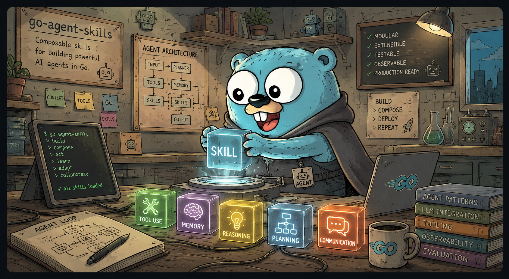

<p align="center">
  
</p>

<p align="center">
  <a href="https://skills.sh/eduardo-sl/go-agent-skills"></a>
  <a href="https://agentskills.io/specification.md"></a>
  <a href="https://github.com/eduardo-sl/go-agent-skills/actions/workflows/validate.yml"></a>
  <a href="https://github.com/eduardo-sl/go-agent-skills/stargazers"></a>
  <a href="LICENSE"></a>
</p>

<h3 align="center">Curated Go skills for AI coding agents.<br>Idiomatic by default, loaded only when they matter.</h3>

<p align="center">
  <a href="#-quick-start">Quick start</a> ·
  <a href="#-usage">Usage</a> ·
  <a href="#-skills">Skills</a> ·
  <a href="#-how-it-works">How it works</a> ·
  <a href="#-evaluations">Evaluations</a> ·
  <a href="#-customizing">Customizing</a> ·
  <a href="#-faq">FAQ</a> ·
  <a href="#-contributing">Contributing</a>
</p>

```bash
npx skills add eduardo-sl/go-agent-skills
```

---

## Why

AI coding agents write Go that compiles. Writing Go that reads like Go takes
more than that. Left to defaults, an agent returns errors with no context,
declares interfaces next to their only implementation, starts goroutines nothing
ever stops, and reaches for `interface{}` where a type parameter belongs.

**go-agent-skills** gives the agent the judgment an experienced Go reviewer
brings: 35 focused skills grounded in [Effective Go](https://go.dev/doc/effective_go),
[Go Code Review Comments](https://go.dev/wiki/CodeReviewComments), and patterns
from large-scale production Go services. They follow the open
[Agent Skills](https://agentskills.io/) standard, work in any compatible agent,
and load **on demand**. Until a skill is relevant, it costs about 135 tokens.

```go
// ❌ Before: the caller gets "sql: no rows in result set" and nothing else
func (s *Service) User(id int) (*User, error) {
    u, err := s.repo.Find(id)
    if err != nil {
        return nil, err
    }
    return u, nil
}

// ✅ After (go-error-handling + go-context): cancellable, wrapped, still matchable
func (s *Service) User(ctx context.Context, id int) (*User, error) {
    u, err := s.repo.Find(ctx, id)
    if err != nil {
        return nil, fmt.Errorf("find user %d: %w", id, err)
    }
    return u, nil
}
```

### Highlights

- 🎯 **35 skills across six areas.** Code quality, architecture, data, safety and performance, testing, and workflow.
- 🪶 **Progressive disclosure.** About 4,800 tokens of descriptions at startup. Bodies and 62 reference files load only when a task needs them.
- 🧭 **A router for overlap.** `go-skills-router` maps a task to the skill that owns it and draws the line where two overlap.
- 🧪 **Measured, not asserted.** 159 eval cases you run with and without the skills. The difference between the two runs is the result.
- 🔐 **Least privilege.** Every skill declares scoped `allowed-tools`. Review and audit skills cannot write.
- 🔄 **Current with Go.** Covers Go 1.21 through 1.27. A weekly workflow opens an issue when a new Go release ships that `go-modernize` doesn't cover yet.
- 🔌 **Agent-agnostic.** Works in Claude Code, Cursor, Codex, GitHub Copilot, Windsurf, OpenCode, Cline, and more.

---

## 🚀 Quick start

Install with the [`npx skills`](https://skills.sh) CLI. It detects the agents you
have and puts each skill where that agent looks for it. That covers **Claude Code**,
**Cursor**, **Codex**, **GitHub Copilot**, **Windsurf**, **OpenCode**, **Cline**,
and [37+ more agents](https://github.com/vercel-labs/skills#available-agents).

```bash
# Everything, interactive
npx skills add eduardo-sl/go-agent-skills

# Look before you install
npx skills add eduardo-sl/go-agent-skills --list

# Only the skills you want
npx skills add eduardo-sl/go-agent-skills --skill go-code-review --skill go-defensive-coding

# Globally, for every project
npx skills add eduardo-sl/go-agent-skills -g

# Non-interactive, for CI and dotfiles
npx skills add eduardo-sl/go-agent-skills --all -y
```

<details>
<summary><b>Claude Code</b>: plugin marketplace</summary>

```bash
/plugin marketplace add eduardo-sl/go-agent-skills
/plugin install go-agent-skills@eduardo-sl
```

Or install the files directly: `npx skills add eduardo-sl/go-agent-skills -a claude-code`

</details>

<details>
<summary><b>Cursor</b></summary>

```bash
npx skills add eduardo-sl/go-agent-skills -a cursor
```

Cursor auto-discovers skills from `.cursor/skills/` and `.agents/skills/`.

</details>

<details>
<summary><b>GitHub Copilot</b></summary>

```bash
npx skills add eduardo-sl/go-agent-skills -a copilot
```

Copilot auto-discovers skills from `.github/skills/`.

</details>

<details>
<summary><b>Codex</b></summary>

```bash
npx skills add eduardo-sl/go-agent-skills -a codex
```

Codex auto-discovers skills from `~/.agents/skills/` and `.agents/skills/`.

</details>

<details>
<summary><b>Windsurf · OpenCode · Cline</b></summary>

```bash
npx skills add eduardo-sl/go-agent-skills -a windsurf
npx skills add eduardo-sl/go-agent-skills -a opencode
npx skills add eduardo-sl/go-agent-skills -a cline
```

</details>

<details>
<summary><b>Shell installer</b>: no Node required</summary>

```bash
git clone https://github.com/eduardo-sl/go-agent-skills.git
./go-agent-skills/scripts/install.sh /path/to/your-go-project --agent claude

# Preview without changing anything
./go-agent-skills/scripts/install.sh /path/to/project --agent claude --dry-run

# Symlink instead of copying, so a `git pull` updates every project
./go-agent-skills/scripts/install.sh /path/to/project --agent claude --symlink
```

Agents: `claude`, `cursor`, `copilot`, `codex`, `windsurf`. Add `--global` to
install into your home directory.

</details>

<details>
<summary><b>Manual copy</b></summary>

```bash
mkdir -p .claude/skills && cp -r go-agent-skills/skills/*/* .claude/skills/   # Claude Code
mkdir -p .cursor/skills && cp -r go-agent-skills/skills/*/* .cursor/skills/   # Cursor
mkdir -p .github/skills && cp -r go-agent-skills/skills/*/* .github/skills/   # Copilot
mkdir -p .agents/skills && cp -r go-agent-skills/skills/*/* .agents/skills/   # Codex / OpenCode
```

</details>

<details>
<summary><b>Keeping them up to date</b></summary>

```bash
npx skills check      # anything out of date?
npx skills update     # bring them current
npx skills list       # what is installed
npx skills remove go-performance-review
```

</details>

---

## 💬 Usage

There is nothing to learn. Work as usual, and the agent loads a skill when your
task matches its description. Agents that support slash commands can also
invoke a skill directly:

```text
/go-code-review
/go-concurrency-review
```

Real tasks usually need more than one skill. These combinations come from
[`go-skills-router`](skills/(workflow)/go-skills-router/):

| Ask your agent | Skills it loads |
| --- | --- |
| "Review this PR" | `go-code-review` |
| "Build a gRPC service with tests" | `go-grpc` + `go-test-quality` + `go-error-handling` |
| "This endpoint is slow under load" | `go-troubleshooting` + `go-performance-review` + `go-database` |
| "Harden this service before launch" | `go-security-audit` + `go-dependency-audit` + `go-defensive-coding` + `go-ci` |
| "Split this monolith" | `go-architecture-review` + `go-refactoring` + `go-semantic-tools` |
| "Scaffold a new CLI" | `go-project-layout` + `go-cli` + `go-ci` + `go-binary-size` |
| "Migrate this to the current Go release" | `go-modernize` + `go-test-quality` + `go-ci` |

> [!TIP]
> To make a project use the skills on every Go task, ask your agent to
> **"set up the Go skills for this repo"**. `go-skills-router` proposes a short
> block for your `CLAUDE.md`, `AGENTS.md`, or Copilot/Cursor rules, and writes it
> only after you approve the diff.

---

## 🧩 Skills

```text
                                ┌──────────────────┐
                                │ go-skills-router │  ← which skill owns this task?
                                └─────────┬────────┘
             ┌────────────────────────────┼────────────────────────────┐
             ▼                            ▼                            ▼
┌─────────────────────────┐  ┌─────────────────────────┐  ┌─────────────────────────┐
│ CODE QUALITY            │  │ ARCHITECTURE            │  │ SAFETY & PERFORMANCE    │
├─────────────────────────┤  ├─────────────────────────┤  ├─────────────────────────┤
│ go-coding-standards     │  │ go-architecture-review  │  │ go-concurrency-review   │
│ go-naming               │  │ go-project-layout       │  │ go-security-audit       │
│ go-code-review          │  │ go-interface-design     │  │ go-defensive-coding     │
│ go-error-handling       │  │ go-api-design           │  │ go-performance-review   │
│ go-context              │  │ go-openapi              │  │ go-observability        │
│ go-modernize            │  │ go-graphql              │  │ go-troubleshooting      │
│ go-data-structures      │  │ go-grpc                 │  │                         │
│ go-documentation        │  │ go-design-patterns      │  │                         │
│                         │  │ go-dependency-injection │  │                         │
│                         │  │ go-cli                  │  │                         │
└─────────────────────────┘  └─────────────────────────┘  └─────────────────────────┘
┌─────────────────────────┐  ┌─────────────────────────┐  ┌─────────────────────────┐
│ DATA                    │  │ TESTING                 │  │ WORKFLOW                │
├─────────────────────────┤  ├─────────────────────────┤  ├─────────────────────────┤
│ go-database             │  │ go-test-quality         │  │ go-dependency-audit     │
│                         │  │ go-test-table-driven    │  │ go-ci                   │
│                         │  │                         │  │ go-refactoring          │
│                         │  │                         │  │ go-semantic-tools       │
│                         │  │                         │  │ go-binary-size          │
│                         │  │                         │  │ go-build-release        │
│                         │  │                         │  │ git-commit              │
└─────────────────────────┘  └─────────────────────────┘  └─────────────────────────┘
```

**Reading the tables.** `Desc` is the description, loaded at startup for
*every* skill. It is the text that decides whether a skill triggers. `SKILL.md`
is what loads when the skill fires. `Tree` adds the `references/` files, which
load only when the skill sends the agent to them. 📚 marks a skill that has
reference files. Figures are approximate tokens (bytes ÷ 4).

### Code Quality

| Skill | What it does | Triggers | Desc | SKILL.md | Tree |
| --- | --- | --- | ---: | ---: | ---: |
| [`go-code-review`](skills/(code-quality)/go-code-review/) | Structured review process with severity classification | "review this code", "check this PR" | 103 | 1,844 | 1,844 |
| [`go-coding-standards`](skills/(code-quality)/go-coding-standards/) 📚 | Style conventions, imports, declarations, struct init, formatting | "check Go style", "fix formatting" | 136 | 1,812 | 2,694 |
| [`go-context`](skills/(code-quality)/go-context/) 📚 | Context propagation, cancellation, timeouts, values | "context usage", "timeout", "context cancellation" | 108 | 2,054 | 3,751 |
| [`go-data-structures`](skills/(code-quality)/go-data-structures/) 📚 | Slices, maps, sets, aliasing, preallocation, nil vs empty | "nil slice", "map iteration", "slice aliasing" | 135 | 2,031 | 2,747 |
| [`go-documentation`](skills/(code-quality)/go-documentation/) 📚 | Godoc conventions, testable examples, deprecation notices | "add godoc", "document this package" | 108 | 1,743 | 2,327 |
| [`go-error-handling`](skills/(code-quality)/go-error-handling/) 📚 | Error wrapping, sentinels, custom types, `errors.Is`/`As` | "handle errors", "error wrapping" | 131 | 2,053 | 2,678 |
| [`go-modernize`](skills/(code-quality)/go-modernize/) 📚 | Generics, slog, errors.Join, slices/maps, range-over-func | "modernize", "use generics", "update Go" | 129 | 2,320 | 8,437 |
| [`go-naming`](skills/(code-quality)/go-naming/) 📚 | Packages, stuttering, initialisms, getters, receivers, error names | "what should I name this", "naming review" | 136 | 2,044 | 2,991 |

### Architecture & Design

| Skill | What it does | Triggers | Desc | SKILL.md | Tree |
| --- | --- | --- | ---: | ---: | ---: |
| [`go-api-design`](skills/(architecture)/go-api-design/) 📚 | REST/gRPC handlers, middleware, graceful shutdown, pagination | "design API", "HTTP handler" | 148 | 1,882 | 2,902 |
| [`go-architecture-review`](skills/(architecture)/go-architecture-review/) 📚 | Package layout, dependency direction, layering, `internal/` | "review architecture", "project layout" | 130 | 2,134 | 2,664 |
| [`go-cli`](skills/(architecture)/go-cli/) 📚 | Flags, subcommands, exit codes, signals, Cobra decision point | "build a CLI", "handle Ctrl+C", "exit codes" | 112 | 1,732 | 2,553 |
| [`go-dependency-injection`](skills/(architecture)/go-dependency-injection/) | Constructor injection, composition root, wire/fx trade-offs | "dependency injection", "remove global state" | 115 | 1,563 | 1,563 |
| [`go-design-patterns`](skills/(architecture)/go-design-patterns/) 📚 | Functional options, factory, strategy, middleware/decorator | "design pattern", "functional options" | 118 | 1,981 | 5,083 |
| [`go-graphql`](skills/(architecture)/go-graphql/) 📚 | gqlgen schema-first, resolvers, dataloaders, complexity limits, field auth | "GraphQL", "gqlgen", "N+1 queries", "dataloader" | 155 | 2,108 | 2,572 |
| [`go-grpc`](skills/(architecture)/go-grpc/) 📚 | Proto design, status codes, interceptors, deadlines, streaming | "gRPC service", "interceptor", "proto design" | 114 | 2,228 | 3,403 |
| [`go-interface-design`](skills/(architecture)/go-interface-design/) 📚 | Consumer-side interfaces, composition, compliance checks | "design interface", "accept interfaces" | 143 | 2,124 | 2,679 |
| [`go-openapi`](skills/(architecture)/go-openapi/) | Spec-first REST with oapi-codegen, validation middleware, oasdiff, contract tests | "OpenAPI", "oapi-codegen", "generate a client from the spec" | 174 | 2,051 | 2,051 |
| [`go-project-layout`](skills/(architecture)/go-project-layout/) | Scaffolding new projects: cmd/internal, module naming, thin main | "new Go project", "scaffold a service" | 114 | 1,868 | 1,868 |

### Data

| Skill | What it does | Triggers | Desc | SKILL.md | Tree |
| --- | --- | --- | ---: | ---: | ---: |
| [`go-database`](skills/(data)/go-database/) 📚 | Connection pools, transactions, sqlc, migrations, repository pattern | "database access", "SQL query", "transactions" | 113 | 2,079 | 5,480 |

### Safety & Performance

| Skill | What it does | Triggers | Desc | SKILL.md | Tree |
| --- | --- | --- | ---: | ---: | ---: |
| [`go-concurrency-review`](skills/(safety)/go-concurrency-review/) 📚 | Goroutine lifecycle, channels, mutexes, race detection | "check thread safety", "goroutine leak" | 140 | 2,242 | 4,521 |
| [`go-defensive-coding`](skills/(safety)/go-defensive-coding/) 📚 | Typed-nil interfaces, slice aliasing, integer overflow, defensive copying | "nil pointer panic", "integer overflow", "defensive copy" | 186 | 2,379 | 5,659 |
| [`go-observability`](skills/(safety)/go-observability/) 📚 | Structured logging (slog), tracing, metrics, OpenTelemetry | "add logging", "tracing", "metrics" | 109 | 2,006 | 5,342 |
| [`go-performance-review`](skills/(safety)/go-performance-review/) 📚 | Allocations, benchmarking, pprof, hot path optimization | "check performance", "reduce allocations" | 134 | 2,390 | 7,184 |
| [`go-security-audit`](skills/(safety)/go-security-audit/) 📚 | OWASP, SQL injection, auth, secrets, input validation | "security review", "check vulnerabilities" | 137 | 2,585 | 7,301 |
| [`go-troubleshooting`](skills/(safety)/go-troubleshooting/) 📚 | Panics, deadlocks, memory/goroutine leaks, pprof diffing, delve | "debug this panic", "memory leak", "deadlock" | 127 | 2,487 | 4,844 |

### Testing

| Skill | What it does | Triggers | Desc | SKILL.md | Tree |
| --- | --- | --- | ---: | ---: | ---: |
| [`go-test-quality`](skills/(testing)/go-test-quality/) 📚 | Test philosophy, subtests, httptest, golden files, fuzz, testcontainers | "add tests", "improve coverage" | 186 | 2,654 | 5,570 |
| [`go-test-table-driven`](skills/(testing)/go-test-table-driven/) 📚 | Deep dive on table-driven tests: when to use, struct design, refactoring | "table-driven test", "test matrix" | 162 | 1,647 | 4,387 |

### Workflow

| Skill | What it does | Triggers | Desc | SKILL.md | Tree |
| --- | --- | --- | ---: | ---: | ---: |
| [`git-commit`](skills/(workflow)/git-commit/) | Conventional Commits, atomic commits, pre-commit verification | "commit changes", "commit message" | 109 | 1,466 | 1,466 |
| [`go-binary-size`](skills/(workflow)/go-binary-size/) | Linker flags, inlining, CGO, build tags, embedded assets, image size | "binary is too big", "shrink the binary", "reduce image size" | 166 | 1,912 | 1,912 |
| [`go-build-release`](skills/(workflow)/go-build-release/) 📚 | Reproducible builds, GoReleaser, SBOMs, cosign signing, provenance, images | "release a Go binary", "set up GoReleaser", "sign the release" | 156 | 1,734 | 3,358 |
| [`go-ci`](skills/(workflow)/go-ci/) 📚 | GitHub Actions, golangci-lint, coverage gates, Makefile parity | "set up CI", "add lint to pipeline" | 149 | 1,972 | 3,150 |
| [`go-dependency-audit`](skills/(workflow)/go-dependency-audit/) 📚 | Module hygiene, `govulncheck`, dep evaluation, go.mod review | "check dependencies", "audit deps" | 136 | 1,843 | 2,356 |
| [`go-refactoring`](skills/(workflow)/go-refactoring/) 📚 | Behavior-preserving steps, extract package, strangler migrations | "refactor this", "break circular dependency" | 142 | 1,958 | 2,563 |
| [`go-semantic-tools`](skills/(workflow)/go-semantic-tools/) 📚 | gopls navigation, go list dependency graphs, semantic rename | "find all callers", "who implements this" | 155 | 1,727 | 2,507 |
| [`go-skills-router`](skills/(workflow)/go-skills-router/) | Routes a task to the skill that owns it, plus the secondary skills to load | "which skill should I use", "what Go skills do you have" | 175 | 2,657 | 2,657 |

---

## 🧠 How it works

Each skill loads in three tiers, and each tier is paid for only when it is needed:

```text
    always loaded             when a task matches            when the skill points there
┌──────────────────┐        ┌──────────────────────┐        ┌────────────────────────┐
│   description    │ ─────▶ │       SKILL.md       │ ─────▶ │    references/*.md     │
│ what it covers,  │        │ procedure, good/bad  │        │ edge cases, recipes,   │
│ when NOT to fire │        │ pairs, checklist     │        │ migrations             │
└──────────────────┘        └──────────────────────┘        └────────────────────────┘
  ~135 tokens each            ~2,000 tokens each              never all at once
  ~4,800 for all 35           2–4 per typical task            ~125,000 in the full tree
```

The descriptions are the only cost paid on every request, Go work or not. A
typical task fires two to four skills. The full tree is about 26 times the
startup cost and is never loaded at once. That gap is the point of
progressive disclosure.

---

## 🧪 Evaluations

A skill that doesn't change the output costs context for nothing.
[`evals/`](evals/) is the harness that tells the difference: 159 cases, each a
realistic prompt with regex assertions and optional rubric checks graded by a
second model.

```bash
# In a project with the skills installed
scripts/run-evals.py --cmd 'claude -p "{prompt}"' --label with-skills

# In one without them
scripts/run-evals.py --cmd 'claude -p "{prompt}"' --label baseline
```

The delta is the measurement. `--cmd` takes any agent CLI, so the same suite
runs against whatever agent you use.

One suite measures something different. `go-skills-router` asserts *which
skill* a task should route to. With 35 skills whose triggers overlap, routing
to the wrong one costs more than any description does. The case format is
documented in [`evals/README.md`](evals/README.md).

> [!NOTE]
> No scores are published here. Results depend on the model, its version, and
> the day you run them, and a score without those three recorded tells you
> nothing. Run the suite against your own agent and judge for yourself.

---

## 🔐 Security

Skills are prompts injected into an agent that already has shell and file-write
access. This repository treats them as security-sensitive:

- **Least-privilege tools.** Every skill declares `allowed-tools`. Review and
  audit skills cannot write, and every `Bash(...)` grant is scoped to one binary.
- **No remote code.** No skill fetches remote content or runs downloaded code.
  The only external hosts referenced anywhere in `skills/` are `github.com` and
  `localhost`.
- **Enforced in CI.** `scripts/validate.sh` rejects unscoped `Bash`, any skill
  that declares itself read-only but asks for `Write`, and any instruction that
  pipes a download into a shell.
- **Scanned on publish.** [skills.sh](https://www.skills.sh/eduardo-sl/go-agent-skills)
  scans every published skill with Socket, Snyk, and Gen Agent Trust Hub.

The threat model and private disclosure process are in [SECURITY.md](SECURITY.md).

---

## 🎚 Customizing

**Your team's conventions win.** The convention skills (`go-coding-standards`,
`go-error-handling`, `go-test-quality`, `go-api-design`, `go-database`,
`git-commit`, and others) are marked as community defaults. To override one
without forking, write a short team skill, or a rule in `CLAUDE.md` or
`AGENTS.md`, that names the skill it supersedes:

```markdown
This skill supersedes `go-coding-standards` for Acme projects.
```

Where the two disagree, the agent follows yours. For deeper changes, fork the
repository and install from your fork with
`npx skills add your-org/go-agent-skills`.

**Fixing triggers.** If a skill fires too often, or doesn't fire when it should,
the fix is its `description` field, because that field is the entire triggering
mechanism. [Open an issue](https://github.com/eduardo-sl/go-agent-skills/issues)
with the prompt that misrouted and the skill you expected. Small wording changes
have a large effect on trigger accuracy.

---

## 🎯 Design principles

- **Written for agents, not readers.** Imperative steps, ✅/❌ contrast pairs,
  and a verification checklist at the end of every skill. Agents learn from
  contrast, not prose.
- **Negative triggers earn their keep.** Every description says what the skill
  does *not* cover and names the skill that does. Loading the wrong skill costs
  more than loading none.
- **Verification is executable.** Where a tool can prove a rule (`go vet`,
  `golangci-lint`, `govulncheck`, `go test -race`), the skill runs that tool
  instead of asking the agent to judge.
- **Small by default.** `SKILL.md` stays within 250 lines. CI warns above that
  and fails above 500. Depth goes in `references/`.
- **Self-contained.** No skill requires another to be loaded first. Skills name
  each other only as pointers. `go-skills-router` is the one index, and it is
  optional too.

---

## 🧱 Repository structure

```text
go-agent-skills/
├── skills/(category)/skill-name/
│   ├── SKILL.md                    # ≤250 lines: procedure, patterns, checklist
│   └── references/                 # depth, loaded only when SKILL.md says so
├── evals/
│   ├── README.md                   # how to measure a skill's worth
│   └── cases/                      # one prompt + assertion suite per skill
├── scripts/
│   ├── install.sh                  # shell installer (--dry-run, --symlink)
│   ├── run-evals.py                # drives any agent CLI
│   ├── validate.sh                 # format, frontmatter, tools, catalogue sync
│   └── check-go-release.sh         # flags Go releases go-modernize doesn't cover
├── docs/
│   ├── SKILL_GUIDELINES.md         # quality bar for authoring
│   └── skill-gap-analysis.md       # what exists, what was rejected, and why
│
│  # platform discovery files: all must list the same skills
├── AGENTS.md · CLAUDE.md · .claude-plugin/marketplace.json
├── .cursor/rules/ · .windsurf/rules/ · .clinerules · .github/copilot-instructions.md
└── .opencode/config.json
```

---

## ❓ FAQ

<details>
<summary><b>Do the skills cost anything when I'm not writing Go?</b></summary>

Only the descriptions, about 4,800 tokens for all 35. Skill bodies load only
when a task matches. To cut that further, install only the skills you use
(`--skill`) or install per project instead of globally.

</details>

<details>
<summary><b>Do I need all 35?</b></summary>

No. Every skill is self-contained and works alone. A good starting set is
`go-code-review`, `go-error-handling`, `go-concurrency-review`, and
`go-test-quality`. Add more as your tasks need them.

</details>

<details>
<summary><b>Which Go versions are covered?</b></summary>

Go 1.21 through 1.27. Advice that depends on a release is labeled with it
(for example, `sync.WaitGroup.Go`, *Go 1.25+*), so the agent checks `go.mod`
before suggesting it. A weekly workflow opens an issue when a new Go release
ships that `go-modernize` doesn't cover yet.

</details>

<details>
<summary><b>Is this only for Claude Code?</b></summary>

No. The skills follow the open [Agent Skills](https://agentskills.io/) standard
and contain no agent-specific instructions. The repository also ships discovery
files for Cursor, Copilot, Windsurf, Cline, and OpenCode, and CI checks that they
list every skill.

</details>

<details>
<summary><b>Can a skill run commands on my machine?</b></summary>

A skill runs nothing by itself. It steers your agent, and it declares the tools it
needs in `allowed-tools`. Some agents pre-approve those tools while the skill is
active, so the grants are kept narrow. Review and audit skills are read-only, and
every `Bash` grant is scoped to a single binary such as `go` or `gofmt`. See
[Security](#-security).

</details>

---

## 🤝 Contributing

Contributions are welcome. The skills are loaded into agents that real
engineers use on real codebases, so a small, correct contribution is worth more
than a large one. Good places to start:

- **A misrouted prompt.** Open an issue with what you typed and the skill you expected.
- **An eval case.** Add a case that fails without the skill and passes with it.
- **A factual fix.** Wrong API, outdated Go version, or an example that doesn't compile.
- **A new skill.** Check [`docs/skill-gap-analysis.md`](docs/skill-gap-analysis.md) first. It lists what has been considered and why.

The budget for each skill:

| | Target |
| --- | --- |
| `description` | ~100–200 tokens: what it does, when to fire, when *not* to |
| `SKILL.md` | ≤250 lines, ~1,000–2,000 tokens: procedure and patterns, nothing else |
| `references/*.md` | Whatever depth needs, loaded on demand |
| Full tree | Under ~10,000 tokens |

Every PR must pass `./scripts/validate.sh` and ship at least one eval case that
fails without the skill. Read [CONTRIBUTING.md](CONTRIBUTING.md) and
[docs/SKILL_GUIDELINES.md](docs/SKILL_GUIDELINES.md) before opening one.

---

## 🙏 Acknowledgements

- [Effective Go](https://go.dev/doc/effective_go): the Go team's guide to idiomatic Go
- [Go Code Review Comments](https://go.dev/wiki/CodeReviewComments): the community's review standards
- [Uber Go Style Guide](https://github.com/uber-go/guide/blob/master/style.md): cited where a convention comes from it
- [Agent Skills](https://agentskills.io/): the open skill specification
- [Vercel Skills CLI](https://github.com/vercel-labs/skills): the `npx skills` distribution ecosystem
- [Anthropic Skills](https://github.com/anthropics/skills): patterns for production-grade skills

The Go gopher was designed by [Renée French](https://reneefrench.blogspot.com/)
and is licensed under [CC BY 3.0](https://creativecommons.org/licenses/by/3.0/).
The banner above is an original drawing in that spirit.

If these skills save you a review cycle, a ⭐ helps other Go developers find them.

## 📝 License

[MIT](LICENSE) © [Eduardo Spinelli de Lima](https://github.com/eduardo-sl)
